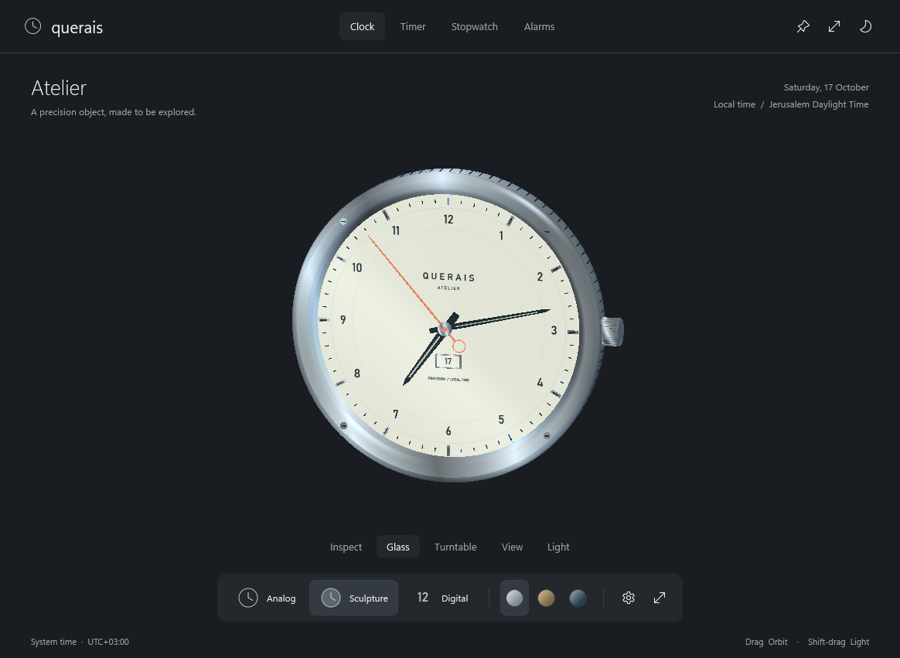
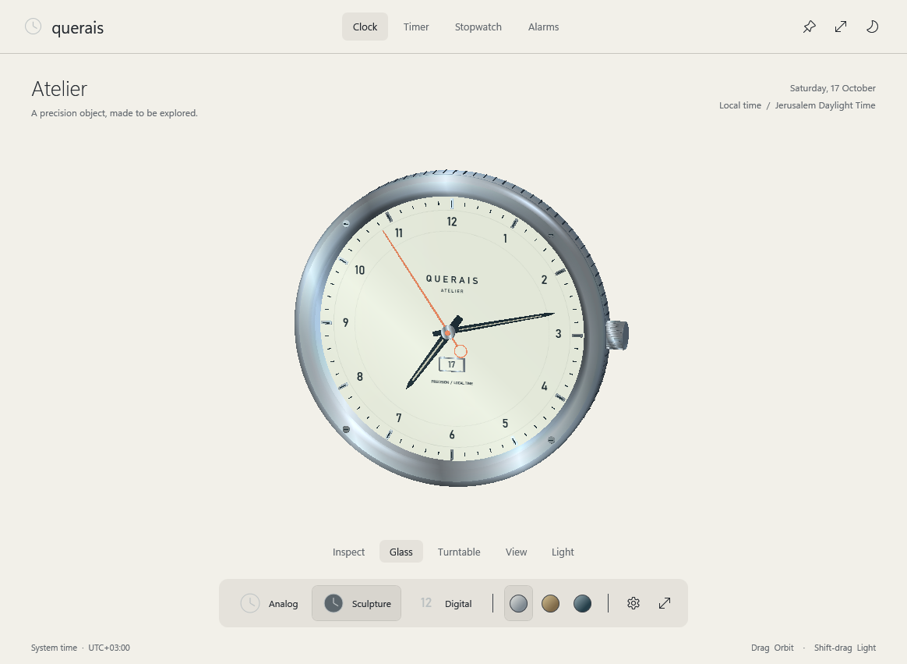
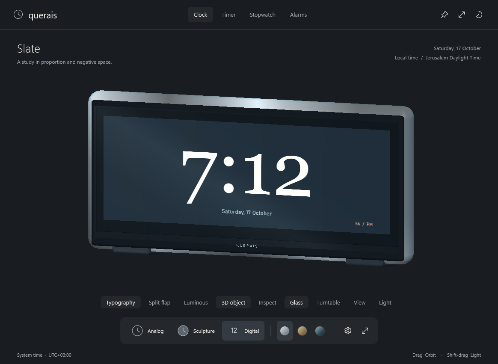
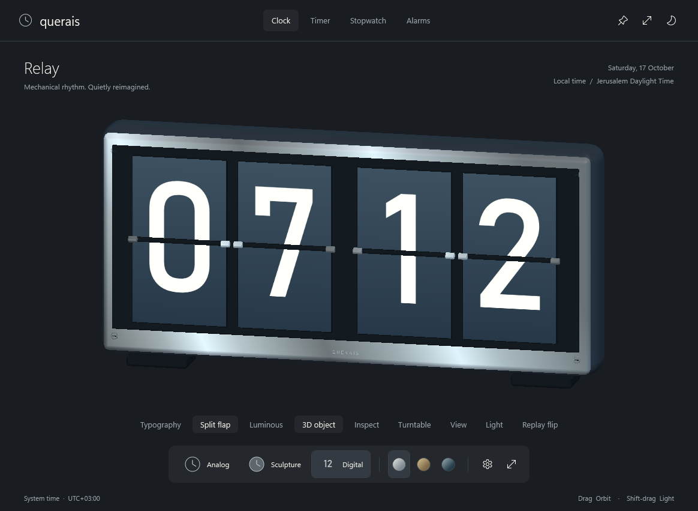
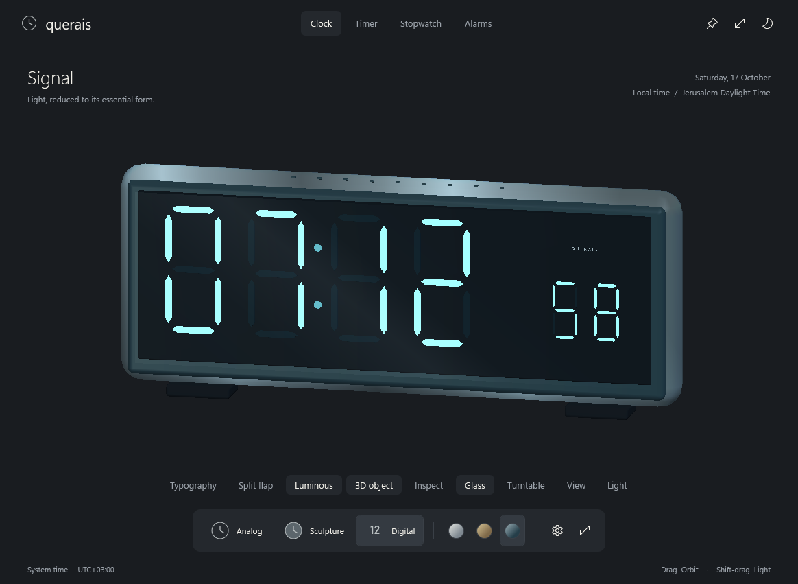
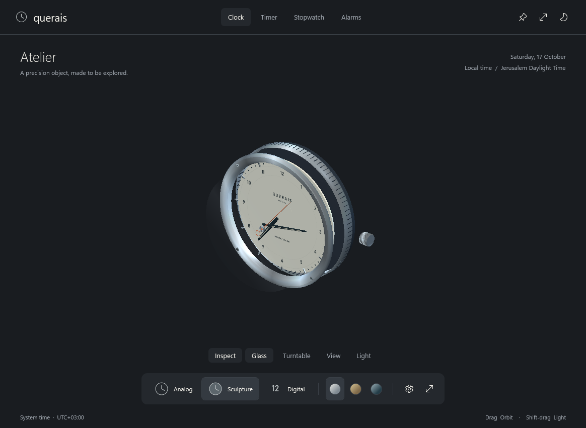

<div align="center">

# Querais

### A clock worth keeping open.

Native Windows. Original 3D objects. A quieter place for time.

[](https://github.com/ShavitR/querais-clock/releases/latest/download/Querais-win-x64.zip)
[](https://github.com/ShavitR/querais-clock/actions/workflows/windows.yml)
[](LICENSE)

[The collection](#four-objects-one-collection) · [Build](#build-from-source) · [Contribute](CONTRIBUTING.md)



</div>

Querais is a free, open-source desktop clock for Windows. Keep a beautiful clock on your desk, explore its construction, or switch to a focused timer. Familiar caption controls, resizing, snapping, keyboard focus, context menus and a tray menu keep it native.

The objects are real meshes with live timekeeping. No webview, account, hosted service or network connection is needed to use the app.

## Get it

1. [Download the latest Windows x64 ZIP](https://github.com/ShavitR/querais-clock/releases/latest/download/Querais-win-x64.zip).
2. Extract the whole folder.
3. Open **Querais.exe**.

The portable, unsigned release includes .NET. You do not need to install .NET, Blender or Python. A SHA-256 checksum is included with each release.

## Four objects, one collection

| Atelier | Slate |
| --- | --- |
|  |  |
| Fluted metal case, floating hands, live date aperture and engraved caseback. | Glass-fronted typography in an aluminum frame on cantilever feet. |

| Relay | Signal |
| --- | --- |
|  |  |
| Four physical split-flap mechanisms with plates that rotate when the minute changes. | Extruded luminous segments, small seconds, smoked glass and a beveled housing. |

Three finishes—**Silver, Champagne and Petrol**—and light/dark themes. Studio and Precision flat analog faces and all three flat digital faces are included too.

## Pick it up. Turn it over.

Drag to orbit, explore the caseback, or open **Inspect** to separate the assembly. Shift-drag to sculpt the light. Turn the crown, hide the glass, or let the object rotate on its turntable.



| Interaction | Action |
| --- | --- |
| Drag / arrow keys with the object focused | Orbit / fine adjustments |
| Double-click / Home | Reset view |
| Shift-drag | Change light direction and intensity |
| Scroll | Adjust scale |
| Click / drag the analog crown | Toggle seconds sweep / adjust scale |
| Inspect / E with the object focused | Open the assembly |
| Glass / Turntable | Hide the lens / slowly rotate the object |
| View / Light | Camera presets / studio lighting |
| Replay flip | Explore Relay's mechanism, returning to actual time |

Reduced motion suppresses automatic rotation and flap animation. Rendering pauses while hidden or minimized.

## Keep it on your desktop

Focus mode fills the window with the clock. Compact mode, always-on-top and optional close-to-tray behavior help it fit around your work. Preferences and alarms stay local in `%LOCALAPPDATA%\Querais`.

| Shortcut | Action |
| --- | --- |
| Ctrl+1 / Ctrl+2 / Ctrl+3 | Analog / Sculpture / Digital |
| F / Escape | Focus / return or close a popover |
| Ctrl+P / Ctrl+M | Always on top / compact mode |
| Ctrl+, / T | Settings / theme |
| Space | Start or pause timer/stopwatch |
| L / R | Lap / reset active time tool |

Timer, stopwatch and daily or one-shot alarms share the same visual language. Alarms require the app to remain running, including in the tray; they do not wake a sleeping PC. Active timers and stopwatch sessions are not restored after exiting.

## Build from source

You need **Windows and the .NET 10 SDK**. Runtime meshes are included; Blender is optional.

```powershell
git clone https://github.com/ShavitR/querais-clock.git
cd querais-clock
dotnet run --project src/Querais -c Release
```

Create a self-contained portable ZIP and checksum:

```powershell
pwsh ./tools/Build-Release.ps1
```

Output goes to `dist/`. GitHub Actions also builds on Windows and produces a portable artifact.

### Check changes

```powershell
dotnet build src/Querais -c Release
dotnet run --project src/Querais -c Release -- --verify
```

The in-app harness invokes native WPF handlers and captures the visual tree at several sizes. The initial community release passed **28 automated checks**, covering time tools, preferences, model interactions, motion and hidden-window rendering. See [verification details](VERIFICATION.md) for testing limits. Manual DPI, accessibility and multi-monitor qualification remain areas for community help.

## Made to be opened up

Editable source and original artwork are included. Models were created through Blender MCP and inspected with actual Cycles renders. The running app uses geometry, live surfaces and independently moving parts; the previews are not substituted for interactive clocks.

- [Editable Blender collection](assets/querais-collection.blend)
- [GLBs, runtime meshes and preview renders](assets/collection)
- [Asset authoring guide](docs/ASSET_AUTHORING.md)
- [Architecture](docs/ARCHITECTURE.md)

Native WPF materials approximate the richer Cycles materials. Windows supplies the fonts; font files are not bundled.

## Make it yours

Bug fixes, accessibility improvements, rendering work and thoughtful faces are welcome. Read [CONTRIBUTING.md](CONTRIBUTING.md), [open an issue](https://github.com/ShavitR/querais-clock/issues), or send a pull request. Keep the app calm, native and useful; give each clock its own character.

**[MIT licensed](LICENSE)**, including original Querais geometry and artwork. See [third-party notices](THIRD_PARTY_NOTICES.md) for runtime and authoring-tool credits.
