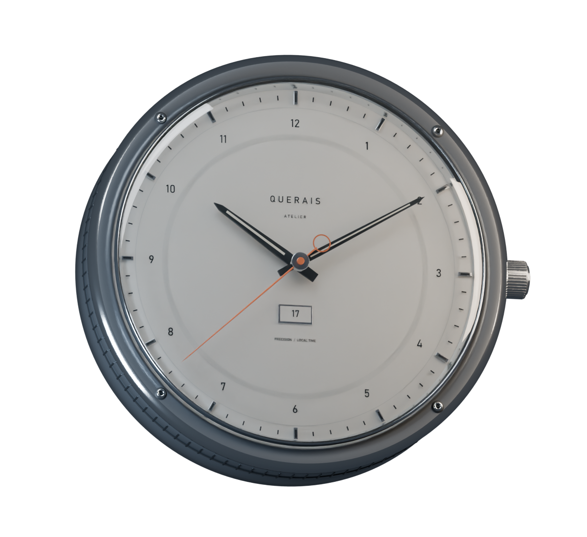
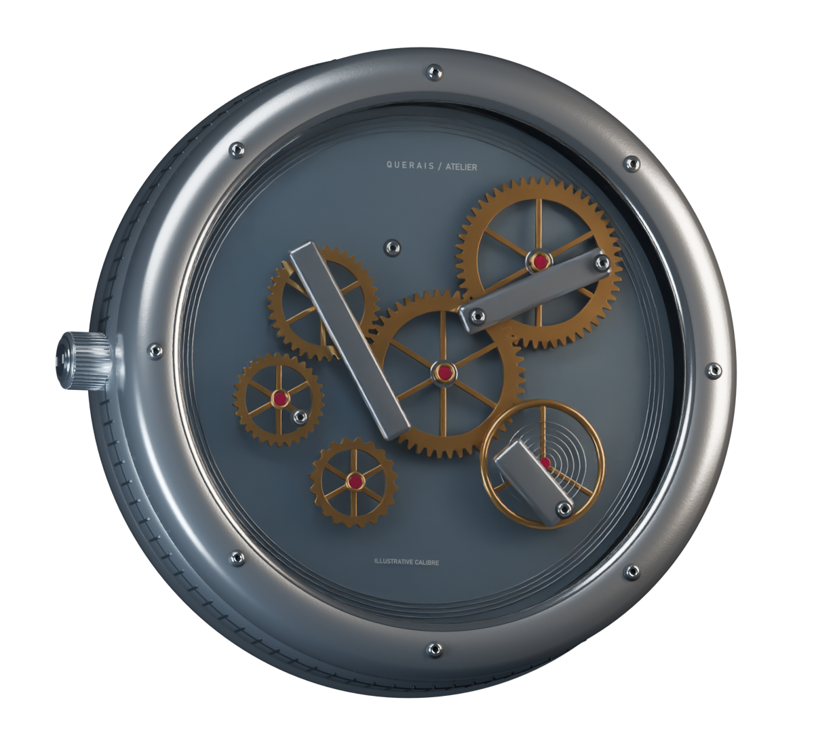
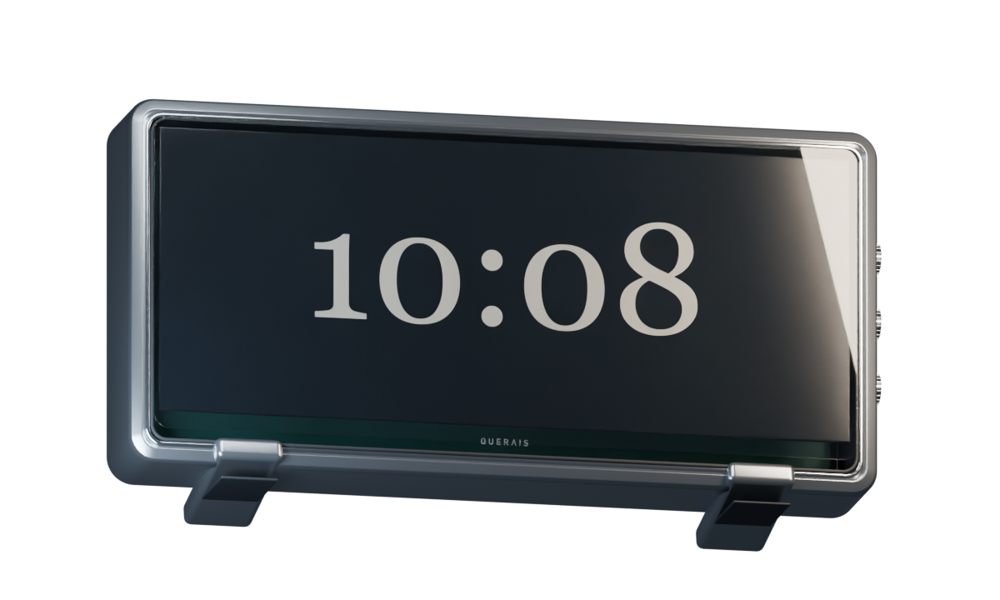
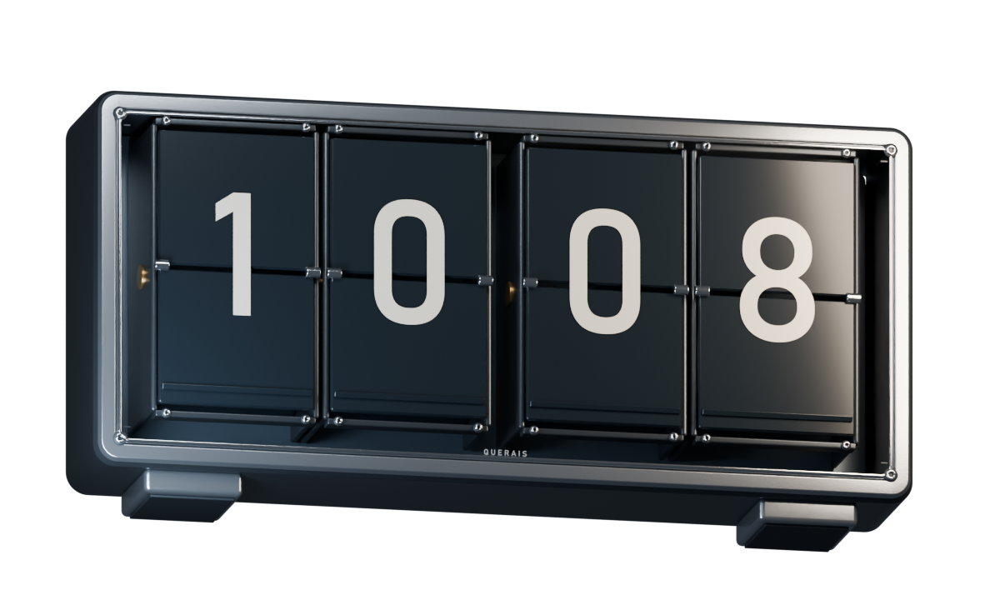
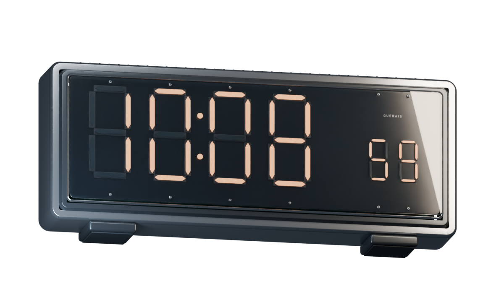
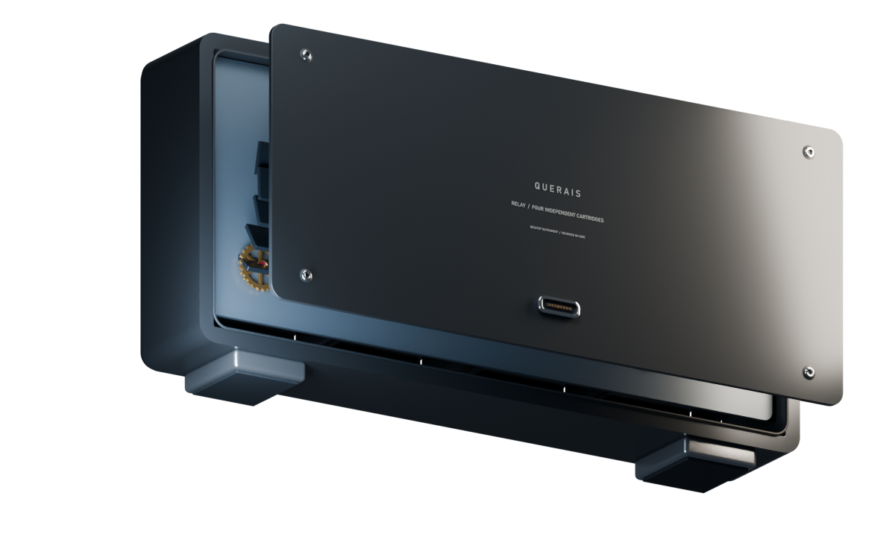

# The objects in Blender

Original geometry rendered in Cycles through Blender MCP. These are asset previews; the running Windows app uses native live meshes with its own lighting and materials.

| Atelier | Exhibition movement |
| --- | --- |
|  |  |

| Slate | Relay |
| --- | --- |
|  |  |

| Signal | Relay inspection |
| --- | --- |
|  |  |

Editable source: [querais-collection.blend](../assets/querais-collection.blend). Compressed [GLBs and native meshes](../assets/collection) are included. [Authoring instructions](ASSET_AUTHORING.md) explain scene isolation, pivots, reproducible exports and the runtime budgets.
